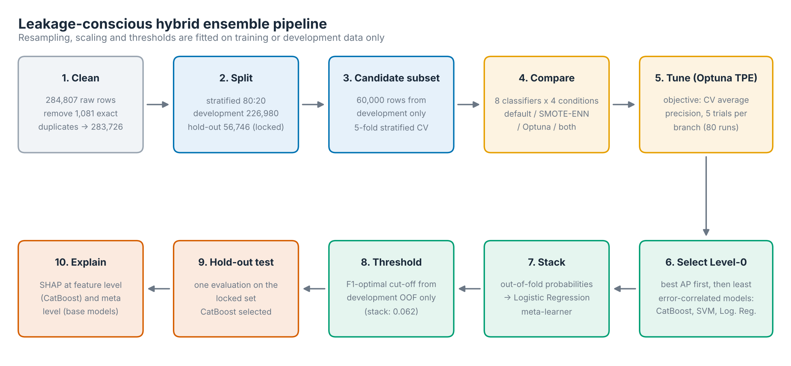
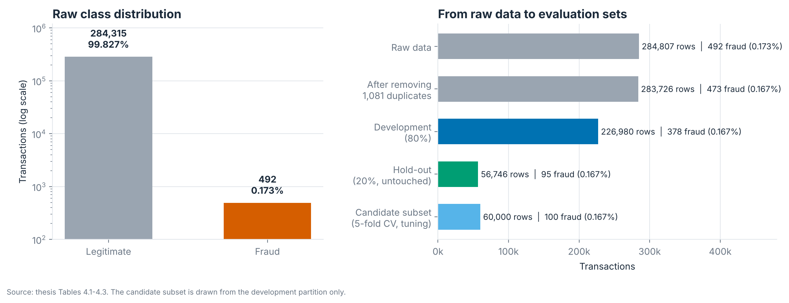
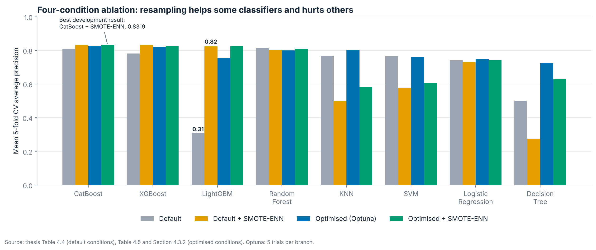
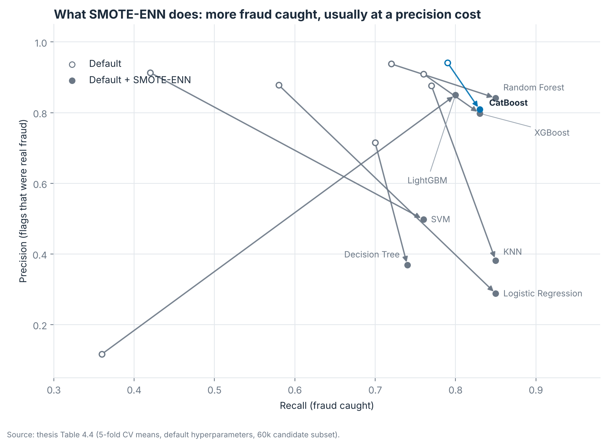
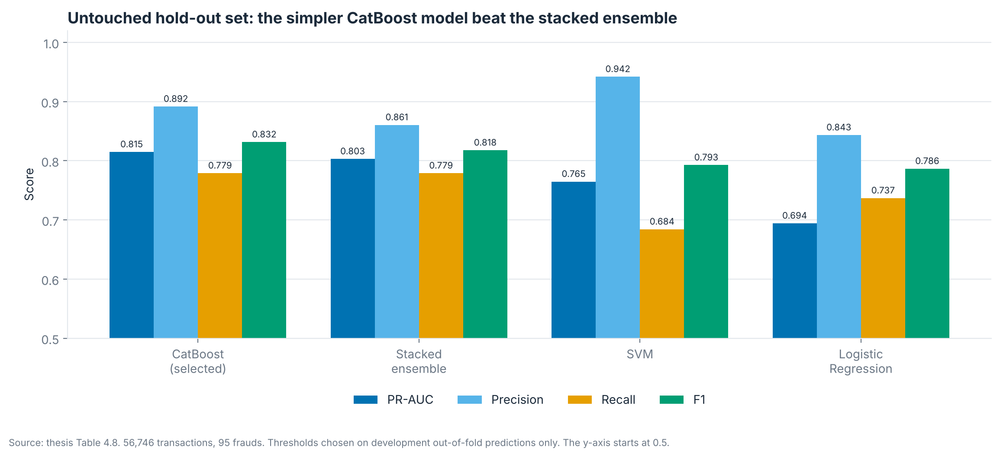
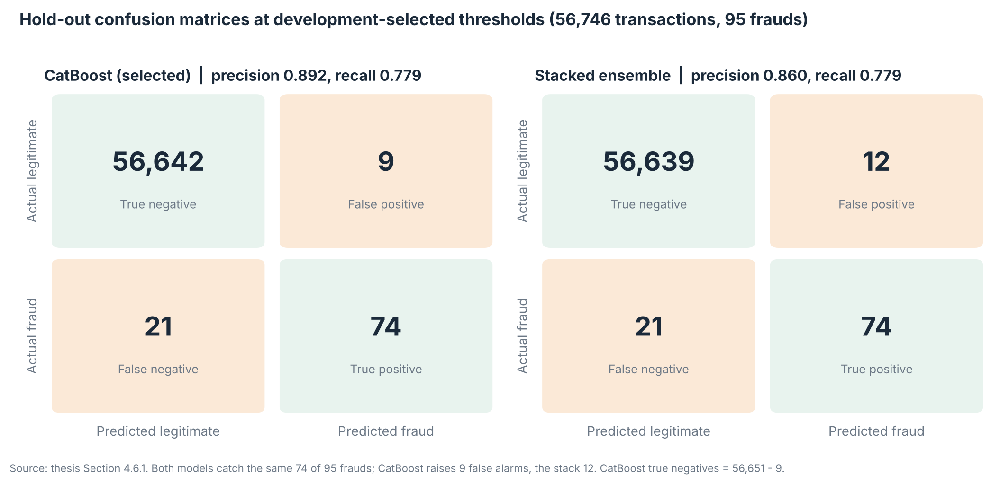
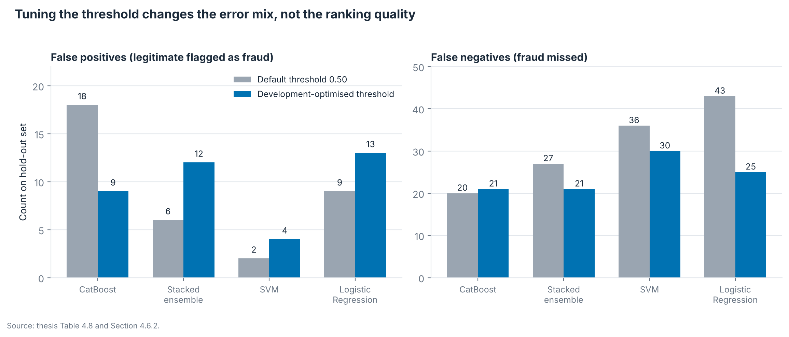
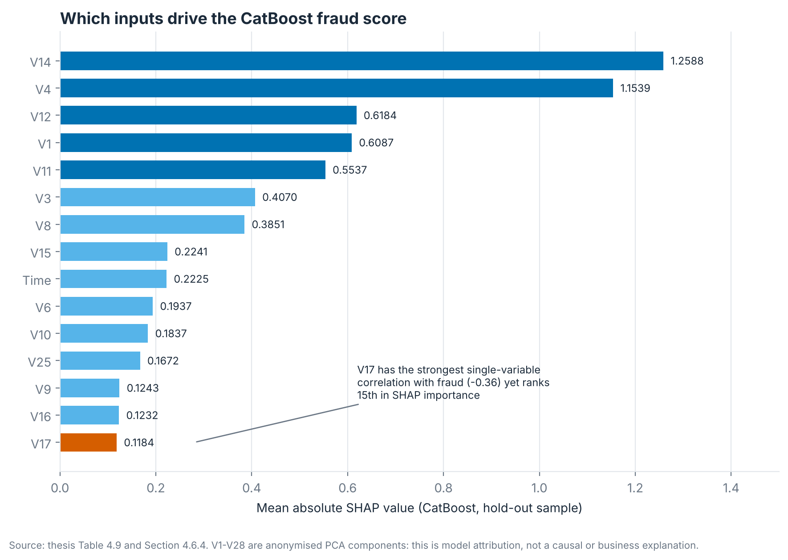

# Explainable Credit Card Fraud Detection: Adaptive, Hyperparameter-Optimised Hybrid Ensemble


**Portfolio summary.** MSc Data Science thesis project, IU International University of Applied Sciences
(Berlin), 2026 (grade 1.7). An end-to-end machine-learning study of rare-event fraud detection that
demonstrates leakage-safe evaluation, imbalance handling, Bayesian hyperparameter optimisation,
complementarity-based ensemble design, threshold tuning and model explainability. It also reports a
negative result honestly: the stacked ensemble did not beat its best single model.

**Contents:**
[Key results](#key-results) |
[Objectives](#objectives) |
[Data](#data) |
[Method](#method) |
[Results](#results-untouched-hold-out-56746-transactions-95-frauds) |
[Explainability](#explainability-shap) |
[Repository structure](#repository-structure) |
[Reproduce](#reproduce) |
[Limitations](#limitations) |
[Future work](#future-work)

## Key results

Evaluated once on an untouched hold-out set (56,746 transactions, 95 frauds), with the threshold chosen on development data only.

| Metric | Selected model: CatBoost | Stacked ensemble |
|---|---|---|
| PR-AUC | **0.8148** | 0.8030 |
| Precision | **0.8916** | 0.8605 |
| Recall | 0.7789 (74 of 95 frauds) | 0.7789 (74 of 95 frauds) |
| F1 | **0.8315** | 0.8177 |
| False alarms (legitimate flagged) | **9** | 12 |

- **Dataset:** 283,726 unique transactions after removing 1,081 duplicates; fraud rate 0.167%.
- **Scope:** 8 classifiers compared under 4 conditions (default, SMOTE-ENN, Optuna, Optuna + SMOTE-ENN).
- **Best development result:** CatBoost + SMOTE-ENN, CV average precision 0.8319.
- **Top SHAP features:** `V14`, `V4`, `V12`, `V1`, `V11` (anonymised PCA components).
- **Takeaway:** the added complexity of stacking was not justified by hold-out evidence, so the simpler model was chosen.

## Overview

An end-to-end, leakage-conscious machine-learning pipeline for detecting fraud in an extremely
imbalanced dataset (0.17% fraud). It compares eight classifiers under four conditions, builds a
stacked ensemble from *complementary* models, tunes the decision threshold, and explains the
final model with SHAP.

**Headline finding:** the stacked ensemble did **not** beat its best single model on the untouched
hold-out set, so the simpler CatBoost model was selected. The framework tested the "ensemble adds
value" hypothesis and the independent evidence did not support it.



## Objectives

- Detect fraudulent transactions in a rare-event setting (0.17% fraud).
- Handle class imbalance without leaking information into evaluation.
- Judge models with imbalance-aware metrics (PR-AUC / average precision, precision, recall, F1) rather than accuracy, which a "predict everything legitimate" model would score at 99.8%.
- Provide an interpretable workflow with SHAP at feature level and at ensemble level.

## Highlights

- **Leakage control:** duplicates removed before splitting; 80:20 stratified split with an untouched hold-out set; scaling and SMOTE-ENN fitted on training folds only; thresholds chosen on development out-of-fold predictions only.
- **Eight classifiers:** Logistic Regression, Decision Tree, Random Forest, KNN, SVM, XGBoost, LightGBM, CatBoost.
- **Four-condition ablation:** default, default + SMOTE-ENN, Optuna-optimised, optimised + SMOTE-ENN.
- **Bayesian optimisation:** Optuna with the TPE sampler, objective = mean 5-fold CV average precision (not accuracy).
- **Complementarity-based stacking:** Level-0 models (CatBoost, SVM, Logistic Regression) chosen by out-of-fold error correlation, not just by rank; Logistic Regression meta-learner trained on out-of-fold probabilities.
- **Explainability:** SHAP at feature level (CatBoost) and at meta level (base-model probabilities).

## Data

[Credit Card Fraud Detection dataset (ULB / Kaggle)](https://www.kaggle.com/datasets/mlg-ulb/creditcardfraud):
284,807 transactions over two days, 492 frauds. Features `V1`-`V28` are anonymised PCA components,
plus `Time`, `Amount` and `Class` (0 = legitimate, 1 = fraud). There are no missing values.
After removing 1,081 exact duplicates (1,062 legitimate, 19 fraud): 283,726 transactions (473 fraud).
Place `creditcard.csv` in a `data/` folder (it is git-ignored).



| Partition | Transactions | Fraud | Fraud rate |
|---|---|---|---|
| Full development (80%) | 226,980 | 378 | 0.1665% |
| Untouched hold-out (20%) | 56,746 | 95 | 0.1674% |
| Candidate subset (from development, for CV and tuning) | 60,000 | 100 | 0.1667% |

## Method

1. **Clean and split.** Remove exact duplicates, then split 80:20 with stratification. The hold-out set is never resampled or tuned on.
2. **Compare classifiers.** Five-fold CV on a 60,000-row stratified subset of the development data, with and without SMOTE-ENN (minority-to-majority ratio 0.10, applied to training folds only).
3. **Tune.** Optuna/TPE, 5 trials per classifier and branch (80 runs), objective = mean CV average precision.
4. **Select Level-0 models.** Rank by optimised AP, keep the best (CatBoost), then add the models whose out-of-fold errors correlate least with the selected ones (SVM, then Logistic Regression).
5. **Stack.** Logistic Regression meta-learner on out-of-fold probabilities.
6. **Set thresholds** by maximising F1 on development out-of-fold predictions, then freeze them.
7. **Evaluate once** on the hold-out set and explain with SHAP.

### Does resampling help? It depends on the classifier



SMOTE-ENN raised recall for all eight optimised classifiers and lowered precision for all of them.
It improved average precision only for CatBoost, LightGBM, Random Forest and XGBoost, and made it
worse for Decision Tree, KNN, Logistic Regression and SVM. The best development result was
CatBoost + SMOTE-ENN with CV average precision 0.8319 (SD 0.0722).



### Stacking: complementary models, not just the top three

The three boosters made very similar errors (XGBoost vs LightGBM error correlation 0.877), so picking
the top three by AP would have given three near-copies. CatBoost, SVM and Logistic Regression were chosen
instead (SVM-CatBoost error correlation 0.392). In the meta-learner, CatBoost dominates:

| Level-0 model | Meta coefficient |
|---|---|
| CatBoost | 6.5452 |
| Logistic Regression | 2.2533 |
| SVM | 1.7926 |

## Results (untouched hold-out: 56,746 transactions, 95 frauds)

Thresholds were chosen on development data only (CatBoost 0.760, SVM 0.016, Logistic Regression 0.169, stack 0.062).

| Model | PR-AUC | Precision | Recall | F1 | FP | FN |
|---|---|---|---|---|---|---|
| **CatBoost** | **0.8148** | 0.8916 | 0.7789 | **0.8315** | 9 | 21 |
| Stacked ensemble | 0.8030 | 0.8605 | 0.7789 | 0.8177 | 12 | 21 |
| SVM | 0.7647 | **0.9420** | 0.6842 | 0.7927 | 4 | 30 |
| Logistic Regression | 0.6942 | 0.8434 | 0.7368 | 0.7865 | 13 | 25 |

The stacked ensemble also reached ROC-AUC 0.972. ROC-AUC is optimistic on data this imbalanced,
which is why PR-AUC is the headline metric.



CatBoost and the stack catch the same 74 of 95 frauds; CatBoost raises 9 false alarms against 12.



The default 0.50 threshold is not a sensible shared operating point: each model's scores sit on a
different scale, so thresholds were tuned per model on development data.



## Explainability (SHAP)

`V14`, `V4`, `V12`, `V1` and `V11` were the most influential features in the CatBoost model.
Lower `V14` and `V12` and higher `V4` and `V11` push predictions towards fraud. They are PCA components,
so this is model attribution, not a causal or business explanation. Notably, `V17` has the strongest
single-variable correlation with fraud (-0.36) but ranks only 15th in SHAP importance: univariate
association and multivariate attribution answer different questions.



Running the pipeline additionally writes the SHAP beeswarm and meta-level plots to `outputs/`.

## Repository structure

```text
credit-card-fraud-detection/
├── fraud_detection_pipeline.py      # full experiment, end to end
├── scripts/
│   └── make_thesis_figures.py       # regenerates every figure in images/
├── images/                          # figures used in this README
├── requirements.txt
├── .gitignore
├── README.md
├── data/                            # creditcard.csv goes here (git-ignored)
└── outputs/                         # pipeline results (git-ignored)
```

## Reproduce

```bash
git clone https://github.com/maggotinho35/credit-card-fraud-detection.git
cd credit-card-fraud-detection
python -m venv .venv && source .venv/bin/activate
pip install -r requirements.txt

# quick smoke test (2 Optuna trials, 20k subset)
python fraud_detection_pipeline.py --data data/creditcard.csv --out outputs --fast

# full thesis configuration (5 trials per classifier/branch, 60k subset)
python fraud_detection_pipeline.py --data data/creditcard.csv --out outputs

# rebuild the README figures from the thesis results
python scripts/make_thesis_figures.py
```

Outputs (CSV tables, Optuna studies, SHAP plots, version log) are written to `outputs/`.
The random seed is fixed at 42. Exact numbers can vary slightly with library versions; the log in
`outputs/reproducibility_log.json` records the versions used.

The figures in `images/` are drawn from the results reported in the thesis (tables noted in the
script), not from a fresh run, so they match the thesis exactly.

## Limitations

One public benchmark covering two days; anonymised features; small Optuna budget (5 trials) and a
60k development subset for computational reasons; threshold chosen by F1 rather than business cost.
With only 95 frauds in the hold-out set, one or two transactions move precision and recall noticeably.

## Future work

- Cost-sensitive thresholds that reflect the real price of a missed fraud versus a false alarm
- Probability calibration
- Temporal validation and concept-drift monitoring
- More recent datasets
- Real-time scoring and a Streamlit demo

## Tech stack

Python, pandas, NumPy, scikit-learn, imbalanced-learn, Optuna, XGBoost, LightGBM, CatBoost, SHAP, Matplotlib.

## Author

Ebenezer Arthur, MSc Data Science. [LinkedIn](https://linkedin.com/in/ebenezer-arthur)
